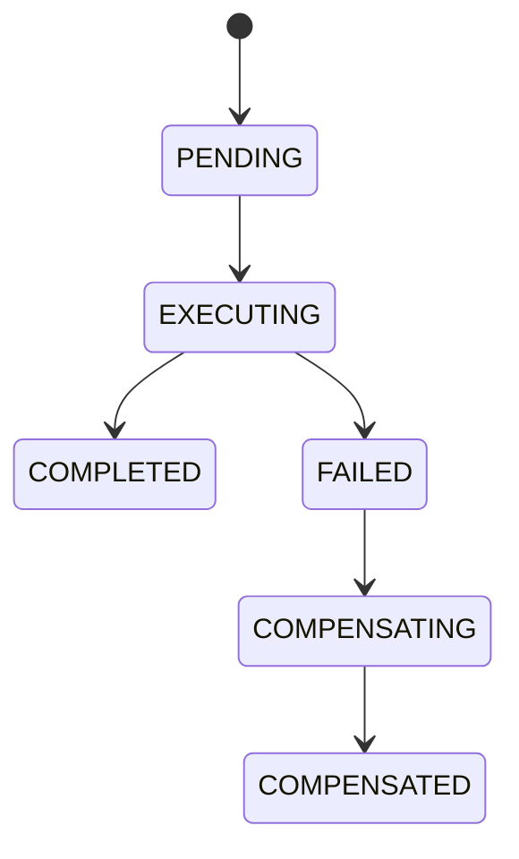

# Saga Design - Watch Management

MSWatch là orchestrator, sở hữu DBWatch. MSBrand là participant, sở hữu
DBBrand. Mỗi bước ghi dữ liệu trong một local transaction của service đó.
MSWatch chỉ gọi API nội bộ của MSBrand, không truy cập trực tiếp DBBrand.

## CREATE_WATCH

| Bước | Thao tác | Database | Compensation | Cách bảo đảm idempotent |
| --- | --- | --- | --- | --- |
| 1 | CREATE_WATCH: insert watch | DBWatch | DELETE_WATCH | Xóa theo WatchID; không tồn tại thì bỏ qua |
| 2 | ASSIGN_BRAND: gán watch vào brand | DBBrand | UNASSIGN_BRAND | Xóa liên kết theo WatchID; đã gỡ trả NOTHING_TO_DO |

## UPDATE_WATCH

Lưu snapshot `before` đầy đủ trước khi cập nhật, gồm BrandID cũ.

| Bước | Thao tác | Database | Compensation | Cách bảo đảm idempotent |
| --- | --- | --- | --- | --- |
| 1 | UPDATE_WATCH: cập nhật watch | DBWatch | RESTORE_WATCH | Gán lại toàn bộ giá trị từ snapshot, không cộng/trừ |
| 2 | ASSIGN_BRAND: chuyển sang brand mới | DBBrand | ASSIGN_BRAND_BACK | Upsert theo WatchID về BrandID cũ |

## DELETE_WATCH

Lưu WatchID và BrandID cũ trước khi bắt đầu.

| Bước | Thao tác | Database | Compensation | Cách bảo đảm idempotent |
| --- | --- | --- | --- | --- |
| 1 | UNASSIGN_BRAND: gỡ liên kết | DBBrand | ASSIGN_BRAND_BACK | Upsert WatchID về BrandID cũ |
| 2 | DELETE_WATCH: xóa cứng watch | DBWatch | Không có - PIVOT | Không bù trừ sau pivot |

DELETE_WATCH là pivot và phải đứng cuối. Khi xóa dòng dùng IDENTITY, không
thể insert thông thường để lấy lại đúng WatchID cũ. Lời gọi mạng có thể thất
bại được thực hiện trước pivot để còn có thể bù trừ. Khi pivot đã commit,
Saga hoàn thành; bỏ qua fault injection sau pivot.

## State machine



Orchestrator không có `@Transactional`. Chỉ đưa các bước đã commit vào
stack; khi thất bại, chạy compensation theo thứ tự ngược (LIFO). Mỗi
compensation retry tối đa 3 lần. Nếu vẫn lỗi, giữ trạng thái COMPENSATING
để xử lý thủ công, không đánh dấu COMPENSATED. SagaState và SagaLog ghi
bằng transaction REQUIRES_NEW để giữ được bằng chứng cả khi một bước lỗi.

## Ví dụ CREATE với brand 999

```text
PENDING -> EXECUTING
1. INSERT watch vào DBWatch -> COMMIT, nhận WatchID 11
2. PUT /internal/brands/999/watches/11 -> 404
FAILED -> COMPENSATING
C1. DELETE watch 11 trong DBWatch -> COMMIT
COMPENSATED -> HTTP 400, failedStep = ASSIGN_BRAND
```

Watch 11 đã commit rồi mới bị xóa bằng một transaction khác. ID tiếp theo
có thể là 12; đây là compensation, không phải rollback của transaction ban đầu.

## Vì sao không dùng một transaction hoặc 2PC

`@Transactional` của MSWatch chỉ quản lý DBWatch, không rollback được
transaction đã commit qua HTTP ở DBBrand. Bao toàn bộ orchestrator bằng
annotation này còn có thể làm mất SagaState và SagaLog khi rollback.
2PC cần coordinator và giữ khóa ở nhiều database trong lúc chờ nhau,
làm các service phụ thuộc chặt vào tính sẵn sàng của nhau. Saga sử dụng
local transaction và compensation để đạt eventual consistency.

Các API assign/unassign phải idempotent vì có thể được gọi lại khi retry.
Lỗi timeout có thể xảy ra sau khi participant đã commit; khi triển khai
orchestrator cần xử lý cả trường hợp kết quả remote chưa xác định, dùng
compensation idempotent để đưa dữ liệu về trạng thái trước đó.
